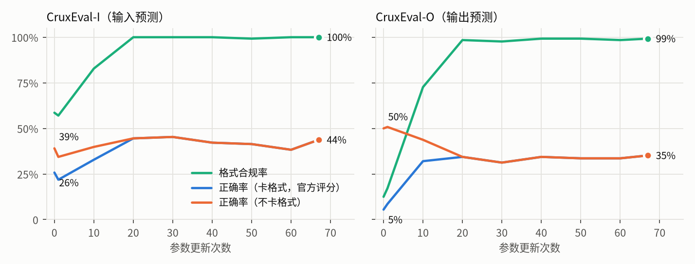
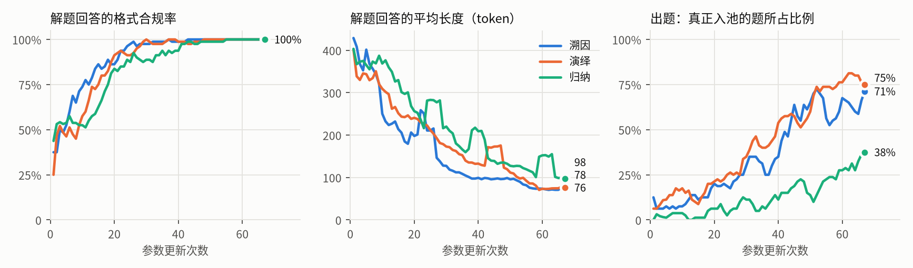

# 实验整理

本仓库只复盘一组实验：用 Absolute Zero Reasoner（AZR）的自博弈强化学习，在一个 3B 的代码模型上做了 67 次参数更新，并在训练前后测量它在独立代码推理题上的表现。

## 研究问题

不给任何人工编写的任务和标注数据，只让一个语言模型自己出题、由代码执行器判对错、自己解题，并据此用强化学习更新自身的全部参数，它的推理能力能否提升？

问这个问题的动机是：人工任务的供给有限，而代码有一个其他领域少有的性质，"这段程序在这个输入上输出什么"可以由机器判定。如果模型能自己编出可执行的题目、自己解出来，学习信号就能绕开人工标注。AZR 是这个方向上公开了代码和种子数据的代表方法。这次实验先小规模跑通它的完整闭环，确认在有限算力上可行，并看训练前后独立题目上的分数怎么变。

## 任务与评估

**流程。**取一个预训练模型，用下文的方法做自博弈训练；在一批固定的、不进入训练的代码推理题上，比较训练前与训练中各个时间点的正确率。

**评估题。**CruxEval 是 800 个短小的 Python 函数，每个带一组输入和对应输出。从中固定抽取 128 个函数，每个函数构造两道题：

- **输入预测（CruxEval-I）**：给出函数和输出，要求写出一个能得到该输出的输入。把预测的输入代入函数执行，结果等于给定输出即为正确，不要求与原输入相同。
- **输出预测（CruxEval-O）**：给出函数和输入，要求写出输出。预测值与真实输出按 Python 的值比较相等即为正确。

题面使用训练时解题者看到的同一套提示：先是一段说明，要求把推理过程写在 `<think> </think>` 中、把答案写在 `<answer> </answer>` 中；随后是题目；最后以 `<think>` 起头让模型续写。解码用 greedy。

**两种评分。**同一份回答打两个分：

- **官方评分（卡格式）**：上游代码自带的评分方式。回答必须从头匹配"`<think>…</think>`，紧接 `<answer>…</answer>`"，否则直接记 0 分；合规的回答再从 `<answer>` 中取出答案，交给执行器判对错。
- **不卡格式评分**：跳过格式检查。回答里有 `<answer>` 就取它后面的内容，没有就取整段回答；之后用同一套答案抽取规则（优先取 ```` ```input ```` 或 ```` ```output ```` 代码块）和同一个执行器判对错。

两个分数的差，就是"答案其实对了、但格式不合规"的题。同时报告格式合规率，即回答通过格式检查的比例。

**统计。**两个时间点之间的比较按题配对：数出同一批题里由错变对、由对变错的题数，并做精确 McNemar 检验。

**训练侧的观测。**在模型自己出的题上，逐步记录两个独立的量：出题回答的格式合规率（写成 `<think>…</think>` 紧接 `<answer>…</answer>` 的比例），以及真正入池率（题目通过全部合法性检查、被加入任务池的比例，每类任务每步采样 16 条）。两者不互相包含，因为题目合法与否只看解析、禁用词和执行结果，不要求回答本身格式合规。另外记录解题回答的格式合规率与长度、任务池规模，用来确认闭环在运转以及模型在学什么。

## 任务与评估 setting

- **模型**：`Qwen/Qwen2.5-Coder-3B`，base 版本（不是 instruct 版本），训练时更新全部参数。
- **评估数据**：`cruxeval-org/cruxeval` 的 800 个函数中随机抽取 128 个，共 256 道题；回答上限 4096 token。
- **训练量**：67 次参数更新，每次用 96 条模型回答，合计约 6400 条；单个随机种子。
- **评估时间点**：第 0、1、10、20、30、40、50、60、67 次更新之后。

## 方法

**任务池。**维护三个任务池 $\mathcal{D}_{\text{ded}}$、$\mathcal{D}_{\text{abd}}$、$\mathcal{D}_{\text{ind}}$。演绎池和溯因池的元素是三元组 $(p, i, o)$，分别对应"给程序和输入求输出"和"给程序和输出求一个输入"；归纳池的元素是 $(p, \{(i_k, o_k)\}_{k=1}^{10}, m)$，对应"给若干输入输出对和一句提示，写出程序"，其中 $m$ 是出题者写给解题者的一句自然语言提示。三个池各用 64 道种子题初始化，种子题来自上游仓库，是作者用同一个基础模型预先生成的。

**出题。**每一步、每类任务构造 $B = 16$ 个出题提示，各采样一个回答：

- 演绎与溯因：从对应任务池均匀抽取 $K = 6$ 道已有题作为参考，要求模型写一个与参考不同的新函数 `f` 和一个输入 $i$。
- 归纳：从演绎池与溯因池的全部程序中均匀抽取一个程序 $p$，要求模型为它写 10 个输入和一句提示 $m$。

回答通过以下检查，题目才算合格（这一步与回答格式是否合规相互独立，格式不合规但内容可解析的回答同样可能产出合格题目）：能从 `<answer>` 中解析出所要求的内容（归纳须恰好 10 个输入）；演绎与溯因的新程序不含禁用词（`random`、`time`、`os.environ` 等会引入随机性或外部状态的名字）；执行器在 10 秒内无报错跑完，并且连续执行两次结果相同。合格的题由执行器算出 $o = p(i)$ 作为标准答案，加入对应任务池。归纳题的 10 组输入输出中，前 5 组展示给解题者，后 5 组隐藏起来用于判分。

**出题奖励。**对每道合格的新题，让当前模型以解题者身份独立作答 $n = 8$ 次，得到平均正确率 $\bar r$。出题奖励定义为

$$
r_{\text{propose}} =
\begin{cases}
1 - \bar r, & 0 < \bar r < 1 \\
0, & \bar r = 0 \ \text{或}\ \bar r = 1
\end{cases}
$$

即 8 次全对（太简单）和 8 次全错（太难或题目本身有问题）都不给奖励，偶尔能答对的题奖励最高。题目的难度因此被拉向"当前解题能力刚够不到"的位置，随解题能力一起上升。

**解题。**每类任务取 $B = 16$ 道题：优先取上一步新入池的题，不足 16 道时从整个任务池均匀补齐。每道题采样一个回答，由执行器判分得 $r_{\text{solve}} \in \{0, 1\}$：演绎比较预测值与 $o$ 是否相等；溯因检查 $p(\hat i) = o$；归纳要求提交的程序在 5 组隐藏输入上的输出全部正确。

**带格式惩罚的最终奖励。**出题和解题的回答都按同一规则换算成最终奖励（$r$ 为上面的 $r_{\text{propose}}$ 或 $r_{\text{solve}}$）：

$$
R =
\begin{cases}
r, & \text{格式合规（出题还须题目合格）且 } r > 0 \\
-0.5, & \text{格式合规（出题还须题目合格）但 } r = 0 \\
-1, & \text{格式不合规，或出题不合格}
\end{cases}
$$

**优势与参数更新。**一步共得到 6 组回答（3 类任务 × 出题、解题 2 个角色），每组 16 条。奖励只在回答结束时给出且不折扣，所以一条回答里每个 token 的回报都是 $R$。优势在每组内部单独标准化：

$$
A = \frac{R - \mu_g}{\sigma_g},
$$

$\mu_g$、$\sigma_g$ 是第 $g$ 组全部回答 token 上回报的均值和标准差。分组标准化是因为六组的奖励水平相差很大（例如训练初期出题多数是 $-1$，解题多数是 $-0.5$），共用一个基线会让一部分组的学习信号被淹没。随后把 96 条回答合成一个 batch，用 PPO 的截断目标加一个很小的熵正则做一次梯度更新，更新全部参数。每一步只在刚采样的数据上更新一次，新旧策略相同，截断并不起作用，这一步等价于使用标准化优势的策略梯度。没有价值网络，也没有约束模型不偏离初始权重的 KL 项。

**算法：一步自博弈训练**

```
输入：模型 π，三个任务池 D_ded、D_abd、D_ind
对每类任务 α ∈ {溯因, 演绎, 归纳}：
    # 出题
    构造 16 个出题提示（溯因、演绎各附 6 道参考题；归纳附 1 个程序）
    用 π 各采样一个回答
    对每个回答：做合格性检查；合格则由执行器算出标准答案，加入 D_α
    对每道合格的新题：用 π 作答 8 次，得平均正确率，算出 r_propose
    按格式惩罚规则得到 16 个出题奖励 R
    # 解题
    从 D_α 取 16 道题（上一步的新题优先）
    用 π 各采样一个回答，由执行器判分，按格式惩罚规则得到 16 个解题奖励 R
对 6 组回答分别做组内标准化，得到优势 A
合并 96 条回答，对 π 的全部参数做一次策略梯度更新
```

## 方法 config

- **学习率**：$10^{-6}$，常数，无 warmup。上游代码在 warmup 步数为 0 时第一次更新的学习率实际是 0，这里改成了从第一次更新起就使用 $10^{-6}$。优化器 AdamW（$\beta = (0.9, 0.999)$，weight decay 0.01），梯度裁剪 1.0。
- **每步数据量**：每类任务每个角色 16 条，共 96 条。官方 3B 配置是 64 条、共 384 条。
- **奖励**：答对 $1$、格式合规但答错 $-0.5$、格式不合规 $-1$；出题奖励用 8 次作答估计；归纳按"隐藏样例全对"二值判分。
- **采样**：训练时温度 1.0、不做 top-p 或 top-k 截断；评估时 greedy。
- **长度上限**：提示 4096 token、回答 4096 token（官方为 6144、8096）；超过 3800 token 的出题提示会被丢弃重抽。
- **出题**：参考题 6 道；归纳题 10 个输入；每个任务池 64 道种子题（官方为 256）；执行超时 10 秒。
- **策略梯度**：PPO 截断 0.2、每步 1 个 epoch、熵系数 0.001、折扣 1.0。
- 上游代码里用于鼓励题目更复杂、更多样的附加出题奖励，以及让新程序调用已有程序的"组合函数"出题，都处于关闭状态，与官方 3B 脚本一致。

## 结果

**评估集上的三种读数（每个题型 128 题，数值为百分比）与回答长度：**

| | 更新次数 | 0 | 1 | 10 | 20 | 30 | 40 | 50 | 60 | 67 |
|---|---|---|---|---|---|---|---|---|---|---|
| **CruxEval-I** | 格式合规率 | 58.6 | 57.0 | 82.8 | 100 | 100 | 100 | 99.2 | 100 | 100 |
| | 官方评分 | 25.8 | 21.9 | 32.8 | 44.5 | 45.3 | 42.2 | 41.4 | 38.3 | 43.8 |
| | 不卡格式评分 | 39.1 | 34.4 | 39.8 | 44.5 | 45.3 | 42.2 | 41.4 | 38.3 | 43.8 |
| | 回答长度中位数（字符） | 680 | 614 | 470 | 395 | 380 | 346 | 298 | 243 | 303 |
| **CruxEval-O** | 格式合规率 | 12.5 | 17.2 | 72.7 | 98.4 | 97.7 | 99.2 | 99.2 | 98.4 | 99.2 |
| | 官方评分 | 5.5 | 8.6 | 32.0 | 34.4 | 31.2 | 34.4 | 33.6 | 33.6 | 35.2 |
| | 不卡格式评分 | 50.0 | 50.8 | 43.8 | 34.4 | 31.2 | 34.4 | 33.6 | 33.6 | 35.2 |
| | 回答长度中位数（字符） | 1230 | 1240 | 1034 | 442 | 418 | 329 | 310 | 278 | 304 |
| **两项合计** | 官方评分 | 15.6 | 15.2 | 32.4 | 39.5 | 38.3 | 38.3 | 37.5 | 35.9 | 39.5 |
| | 不卡格式评分 | 44.5 | 42.6 | 41.8 | 39.5 | 38.3 | 38.3 | 37.5 | 35.9 | 39.5 |



*评估集上三种读数随训练的变化。20 次更新之后几乎所有回答都格式合规，两种评分重合。*

**训练前（0 次更新）与训练后（67 次更新）的逐题配对比较：**

| 评分方式 | 题型 | 答对题数（共 128） | 由错变对 | 由对变错 | McNemar 精确检验 $p$ |
|---|---|---|---|---|---|
| 官方评分 | CruxEval-I | 33 → 56 | 31 | 8 | $3 \times 10^{-4}$ |
| 官方评分 | CruxEval-O | 7 → 45 | 39 | 1 | $< 10^{-9}$ |
| 不卡格式 | CruxEval-I | 50 → 56 | 18 | 12 | 0.36 |
| 不卡格式 | CruxEval-O | 64 → 45 | 10 | 29 | 0.003 |

**模型自己出的题上的训练动态：**



*每步每类任务只有 16 条回答，曲线为 5 步滑动平均。第三张是真正入池的题所占比例；出题回答的格式合规率与它几乎重合。*

### 解读

**闭环确实在运转。**每次更新后抽查的参数都有非零变化，第 1 步和第 10 步保存的权重与原始权重逐元素比较也确认了这一点。真正入池率（前 10 步的平均对比最后 27 步的平均）在溯因上从 8% 升到 63%，演绎从 14% 升到 70%，归纳从 2% 升到 24%；同期出题回答的格式合规率是 7% 到 63%、12% 到 70%、2% 到 24%，两者几乎重合；三个任务池从各 64 道题增长到 466、537、207 道。解题回答的格式合规率从 56% 升到接近 100%。

**官方评分的上涨全部来自学会了输出格式。**按官方评分，两项合计从 15.6% 涨到 39.5%，看上去翻了一倍多。但训练前的低分主要不是因为答错，而是因为漏写标签。训练前输出预测的 128 条回答里只有 16 条格式合规；77 条完全没有写 `</think>` 和 `<answer>`，其中 73 条仍然用 ```` ```output ```` 代码块给出了答案；35 条写了 `<answer>` 但之前没有闭合 `</think>`。输入预测的 53 条不合规回答里，有 40 条只差最后一个 `</answer>`。这些回答都被直接记了 0 分。不卡格式地看，训练前输出预测的正确率是 50.0%，输入预测是 39.1%。训练之后格式合规率接近 100%，两种评分重合，合计正确率是 39.5%，比训练前不卡格式的 44.5% 还低 5 个点。只看训练前格式就已经合规的那部分题，官方评分也基本没有变化：输入预测 75 道题中答对 33 → 36 道，输出预测 16 道题中答对 7 → 9 道。

**输出预测的真实正确率下降了。**不卡格式评分下，输出预测从 64 题降到 45 题（29 题由对变错，10 题由错变对，$p = 0.003$）；输入预测从 50 题到 56 题，变化在噪声范围内（$p = 0.36$）。下降发生在第 1 到第 20 次更新之间，与两件事同步：格式合规率从 17% 升到 98%，回答长度中位数从 1240 字符降到 442 字符。看具体回答，训练前模型会把输入代入程序、逐步写出每个中间值再给出结果；训练后它只用几句话概括函数的功能，然后直接写答案。例如对"统计列表中每个字符串出现次数"的函数，训练前的回答逐个元素累加得到 `{'La': 3, 'Q': 1, '9': 1}`，训练后的回答只描述了"函数会统计出现次数"，给出的答案是 `{'La': 2, 'Q': 1, '9': 1}`。在模型自己出的题上也是同样的趋势：解题回答的平均长度从约 400 token 降到 80 到 100 token。

为什么学格式会连带缩短推理，这次实验没有验证。一个与数据相符的猜测是：格式不合规的惩罚（$-1$）比答错（$-0.5$）更重，而训练初期绝大多数回答都拿不到正奖励，所以最先被强化的是"写出 `</think>` 和 `<answer>`"这个动作本身；这些标签是模型原本很少写的，把它们在各个位置出现的概率整体抬高，推理就会更早被结束，逐步推演的过程也就被压缩掉了。

**20 次更新之后评估集上的正确率不再变化。**从第 20 次到第 67 次更新，输入预测 57 → 56 题，输出预测 44 → 45 题。这段时间里变化的主要是出题一侧：真正入池率继续上升（溯因约从 30% 到 80%），任务池继续增长，但还没有反映到评估集上。

**这些结果的适用范围。**训练只有一个随机种子，评估集每个题型 128 题。更重要的是，67 次更新、每次 96 条回答，只相当于 AZR 完整训练最开始的一小段。上面的现象描述的是这套方法在最初阶段做了什么，不能用来判断完整训练是否有效。

## 对比已有研究

没有任务和评估 setting 一致的已有论文，所以不存在直接可比的结果：没有论文报告过 Qwen2.5-Coder-3B 在 CruxEval-I、CruxEval-O 上训练前后的逐项数字，也没有论文在这么小的训练量上评估过 AZR。下面按可比性从强到弱排列。

**AZR 原论文（arXiv:2505.03335）。**同一个模型、同一套代码、同一套卡格式的评分方式，差别只在训练量。

- 论文每步 384 条回答，3B 模型的曲线画到约 250 步，发布的 3B 权重取自第 100 步。按回答条数折算，我们的 67 次更新（每次 96 条）约等于论文的 17 步。
- 分布内评估（CruxEval-I、CruxEval-O、LiveCodeBench-Execution 合成的一个数）：论文的 3B 曲线从第 50 步开始画，第 50、100、150、200、250 步约为 37.2、43.0、45.7、45.3、43.6，并称 3B 模型"似乎进入平台"。曲线没有训练前的点，官方脚本也不在训练前做评估，所以论文本身也没有回答"原始模型在这套卡格式评分下是多少分"。我们训练后两项的平均是 39.5，落在论文第 50 步与第 100 步的数值之间，但我们的整段训练都发生在论文画出的第一个点之前。
- 分布外评估：论文报告 3B 模型的代码平均分从 51.2 到 54.9，数学平均分从 18.8 到 26.5。我们没有做这类评估。

**同一模型、同一套种子任务上的格式奖励对照（预印本，doi:10.5281/zenodo.23359965）。**在 Qwen2.5-Coder-3B 上用 AZR 的种子任务、只训练解题者，做了两种奖励的对照：把奖励换成"只要带 `<think>`、`<answer>` 标签就给分"，格式合规率同样在约 15 步内从 52% 升到 99.5%，但迁移到数学题上的成绩没有提升（−1.9）；用执行器判对错的奖励则有 +5 到 +6。它没有测 CruxEval，所以回答不了"分布内指标上格式占多少"。它和我们的关系最直接的两点是：模型与任务来源相同，以及"约 15 步学会格式"的时间尺度与我们的前 10 到 20 次更新吻合。

**更大规模、同协议的 AZR 复现（arXiv:2609.32228）。**在 Qwen2.5-Coder-7B 上按 AZR 的配置训练 200 步、3 个随机种子，报告 CruxEval-I 从 48.98 到 59.63、CruxEval-O 从 50.89 到 61.23；只训练解题者、不训练出题者时是 58.05、60.20。论文说明编程部分的训练循环直接沿用 AZR，评测只写了 greedy，没有描述用哪种提示与抽取方式，所以很可能与我们一样是卡格式的评分；如果如此，它那约 10 个点的涨幅里也有一部分来自格式学习，从报告的数字里分不出来（7B 模型本身更会按格式作答，起点被压低得少，所以看不到我们这种"训练前只有 5.5%"的塌陷）。能直接读出来的只有一条：它的提升绝大部分不依赖对出题者的训练。

**同一模型在同一批题上的公开成绩（不同提示协议）。**Qwen2.5-Coder 技术报告（arXiv:2409.12186）给出 Qwen2.5-Coder-3B（base）带逐步推理的成绩：输入预测 46.5，输出预测 43.8。arXiv:2606.17648 用 CruxEval 官方的直接作答提示测得同一模型输出预测 39.0。这些数与我们不卡格式评分下的训练前成绩（39.1、50.0）处于同一水平，而我们训练后的成绩（43.8、35.2）没有超过它们。这与正文的结论一致：官方评分下的低起点量的是格式，不是能力。

**对 AZR 收益的其他复核。**官方仓库的 issue #27 中，第三方用官方代码训练 Coder-3B，在原始模型与训练后模型使用同一种答题模板时，官方发布的权重在数学六项上只比原始模型高 1.9 点（19.4 对 17.5）；论文中两者使用的模板不同。Towards Understanding Self-play for LLM Reasoning（arXiv:2510.27072）用 AZR 代码分析 Coder-3B 和 7B，认为收益主要是把已有能力的输出分布变得更集中，并同样观察到熵的塌缩。

**"强化学习早期的提升主要是格式"已被多篇工作报告。**

- arXiv:2505.19439 在数学任务上观察到，前 15 步的格式学习带来了总提升的 85% 以上，同时回答变得更短；只奖励格式就能得到与奖励正确性相近的早期提升，之后停滞。
- Spurious Rewards（arXiv:2506.10947）显示 Qwen2.5-Math-7B 在只奖励"出现 `\boxed{}`"时 MATH-500 也能涨 13.8 点。
- Same Answer, New Box（arXiv:2610.20639）发现，一批强化学习论文报告的分布外提升中，有 82% 在换用能从正文读出答案的抽取方式后消失。

**对照之后的定位。**我们看到的"前 20 次更新学会格式"与上述工作在时间尺度和现象上都吻合。已有工作没有覆盖的只有一点：格式学会的同时，不卡格式的输出预测正确率显著下降。arXiv:2505.19439 观察到的是回答变短而成绩上升；我们这里是回答变短、逐步推演消失、成绩下降。由于不存在 setting 一致的论文，这一点既无法用别人的数字确认，也无法用别人的数字反驳。

**要让我们与这些工作可比，需要：**先把训练量和评估集对齐到官方配置（每类任务每角色 64 条、提示与回答上限 6144 与 8096、训练 100 至 200 步、完整的 CruxEval-I/O 与 LiveCodeBench-Execution、至少 3 个随机种子，并包含训练前的评估点）；在此之前，先不训练，只用两种评分评估官方发布的 3B 权重，确认我们的评估链路与"训练后真实正确率是否超过原始模型"这两个问题。具体做法见"给出后续建议"一节的前两条。

## 给出后续建议

按优先级排列。前两条让结果能与已有工作对上，后面的才是推进问题本身。

1. **不训练，先评估官方发布的 3B 权重。**用同一批 256 题、两种评分，评估原始模型和官方第 100 步的权重。这一步只需要推理，能直接回答"训练到论文的规模后，不卡格式的正确率是否超过原始模型的 44.5%"，同时检验我们的评估链路。它成本最低，也决定了后面所有对比是否有意义。
2. **按官方配置训练。**每类任务每角色 64 条、提示与回答上限 6144 与 8096、每池 256 道种子题，训练 100 到 200 步（作者建议 3B 在这个范围内停止），每 10 步评估一次并包含训练前的点，至少 3 个随机种子。评估集与协议同时对齐：分布内用完整的 CruxEval-I、CruxEval-O 和 LiveCodeBench-Execution，两种评分都报；分布外用论文的代码与数学基准，并且原始模型与训练后模型使用同一种答题模板。按这次每步约 11 到 13 分钟、回答条数放大 4 倍粗略外推，100 步约需 4 张卡跑 3 天多。
3. **验证"格式惩罚压缩了推理"这个猜测。**对照两种设置：一是把格式不合规与答错的惩罚设成相同，或在算奖励时不卡格式；二是在提示里放一个合规示例，让原始模型从第一步起格式就基本合规。如果这两种设置下回答长度不再骤降、输出预测也不再下降，猜测成立。
4. **加入只奖励格式的对照，并在 CruxEval 上用两种评分测量。**现有的格式对照只看了数学迁移，没有人在 AZR 自己的分布内指标上把"格式"与"执行器奖励"的贡献分开。
5. **从第 67 步的权重继续训练，看真实正确率何时回升。**训练结束时的权重和任务池可以从中断处接着用（若手头没有这份权重，按上一节的复现步骤重跑一遍即可得到），继续训练并每 10 步用不卡格式评分评估，可以知道输出预测的下降是暂时的还是持续的。
6. **加入只训练解题者的对照。**arXiv:2609.32228 的结果提示出题者训练的贡献很小，值得在 3B 上确认。

**打分：1。**这次实验的目的是跑通闭环，这一点达到了。但从研究价值看，得到的信息基本已被已有工作覆盖：强化学习最初十几步的提升主要是格式学习，已有多篇论文在不同模型和任务上报告，并且有工作直接在 Qwen2.5-Coder-3B 和 AZR 的任务上做了格式奖励的对照；AZR 完整训练的效果也已有多组独立复现。唯一未被覆盖的观察（学会格式的同时输出预测真实正确率下降）只出现在单个随机种子、约等于官方 17 步的训练量上，原因也没有验证；原论文和 arXiv:2609.32228 在完整训练后的成绩都高于原始模型的常规水平，提示这个下降可能只是训练最初阶段的暂时现象。它目前不足以构成继续做下去的理由。
